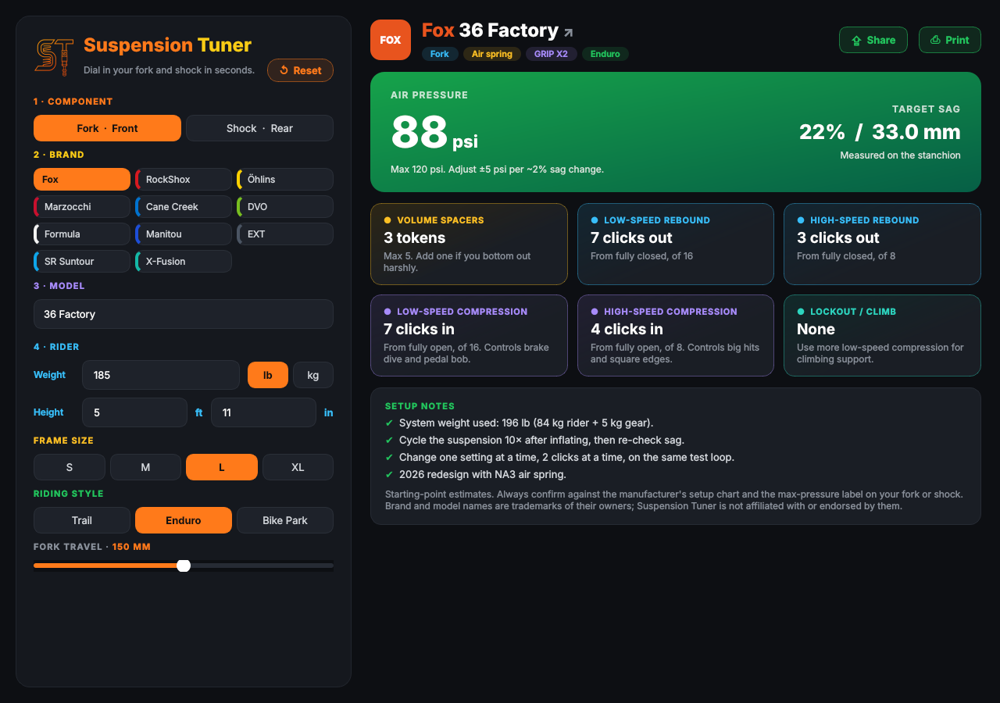
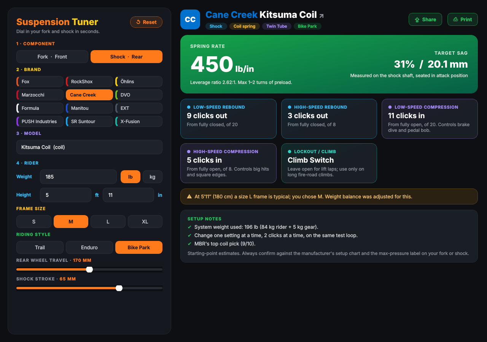

# Suspension Tuner

Pick a fork or rear shock, choose the brand and model, then enter your weight, height, frame size and riding style. The app returns a starting setup: air pressure or coil spring rate, sag, volume spacers, rebound, low- and high-speed compression and rebound, lockout use, fit warnings and setup notes.




## Features (iPhone app)
- **Garage:** save bikes with their fork, shock and rider. The home screen shows the bike with front and rear
  setups; an XC / Trail / Enduro / Bike Park / Downhill switch re-tunes both ends in one tap
- **Tune:** pressure / spring-rate dial with ± nudges (hold to repeat), O-ring sag check, damping sliders and
  token blocks to record what you actually ran, (?) help for sag and damping, Share / Print / Save to History
- **History:** saved setups with date, differences from the recommendation and your notes
- **Settings:** kg / lb, quick calculator (single-screen version), About, erase data
- Tap the brand badge or model name to open the model's spec page on the maker's website
  (`url` in catalog.json; models without a verified page fall back to a search of the brand's site)
- Real brand logos: add images named `logo-<brand>` (`logo-fox`, `logo-rockshox`, `logo-cane-creek`, …) to the
  Assets catalog and they replace the coloured monogram badges

## Layout

| Path | What |
|---|---|
| `apple/Sources/SuspensionKit/Resources/catalog.json` | **Single source of truth**: 65 forks and shocks from 12 brands |
| `apple/Sources/SuspensionKit/` | Swift catalog, calculation engine, saved-bike data model |
| `apple/Sources/SuspensionTunerApp/` | SwiftUI iPhone app |
| `apple/AppResources/` | App icon, `logo-<brand>` images, privacy manifest |
| `apple/project.yml` | XcodeGen spec for the iOS Xcode project |
| `apple/release.sh`, `apple/release/` | App Store archive/upload script and listing text |
| `python/suspension_engine.py` | Python port of the engine (kept 1:1 with `Engine.swift`, used for parity tests) |
| `python/app.py` | Optional PySide6 desktop calculator |
| `tools/` | Website image helpers |

## Run the iPhone app

```sh
cd apple
brew install xcodegen && xcodegen generate
open SuspensionTuner.xcodeproj      # pick an iPhone simulator (or your iPhone) and press ⌘R
```
Open `SuspensionTuner.xcodeproj`, not `Package.swift`: the package only holds the calculation library.

## Publishing
See `apple/release/APP_STORE.md` — listing text, privacy answers, screenshot sizes and the one-command
`TEAM_ID=… ./release.sh --upload` that archives the iPhone app and uploads it to App Store Connect.

Website image: `python3 tools/web_screenshot.py shot1.png shot2.png -o suspension-tuner.png` turns two
Simulator screenshots into one transparent PNG with phone frames.
Then `python3 tools/update_website_image.py --site "/Volumes/MyDrive/Whole Stack Solutions" --image suspension-tuner.png --apply`
swaps it into the Projects page (dry run without `--apply`; old files are backed up).

## Tests
Both engines are pinned to the same golden values:
```sh
cd apple && swift test
cd python && python3 -m unittest test_engine.py
```

## Free and Pro
Free: one bike, the manufacturer setup, pre-ride check and quick calculator. Light, dark or automatic theme (Settings → Appearance).
**Suspension Tuner Pro** (one-time in-app purchase `solutions.wholestack.suspensiontuner.pro`, StoreKit 2 in
`ProStore.swift`) unlocks riding conditions, the sag-check helper, the troubleshooter, unlimited bikes, Save to History,
share & print and the widget. Xcode runs use `apple/StoreKit/Products.storekit` so you can test the purchase for free; set up
the real product as described in `apple/release/APP_STORE.md`.

## Trailside tools
- **Step by step** — under the damping sliders on Tune, the same setup written out in plain words (pump to X psi, fit N spacers, turn the red knob fully clockwise then count N clicks out…) for riders who would rather read than read charts. Uses what you have set on the sliders.
- **Feels off? (symptom troubleshooter)** — pick what the fork or shock is doing (harsh, bottoming, diving, kicking, packing down, bobbing…) and get fixes worked out against *your* current clicks, best first; apply them to the dials or log them to History.
- **Sag check** — guided O-ring routine with a hold-still countdown, then type the mm you measured to get your sag % and the pressure (or spring) to try next.
- **Coil spring sizes** — the nearest stock springs with the sag each gives, and the spring size to buy (e.g. 450 × 2.5″).
- **Pre-ride check** — today's pressures, sag, tires, axles, brakes, headset, dropper, drivetrain and kit; ticks reset daily.
- **Home-screen widget** — small, medium and lock-screen widgets show the selected bike's pump numbers. The app and widget share the garage through the App Group `group.solutions.wholestack.suspensiontuner` (Xcode sets it up when you pick your Team under Signing & Capabilities).

## Where the numbers come from
Each model in `catalog.json` can carry an `mfg` block copied from the maker's own setup guide. The app reads it the way you would read the chart, using your body weight:

| Data | Source |
|---|---|
| FOX 32 SC, 34 SL, 36 SL, 36, 38, 40, Podium | FOX 2026 owner's manuals: pressure by 10 lb row, rebound (GRIP / GRIP X / GRIP X2 LSR + HSR) by row, compression clicks, stock/max volume spacers by travel, 15–20% sag |
| FOX FLOAT SL, FLOAT, FLOAT X, FLOAT X2, DHX2, DHX | FOX 2026 owner's manuals: start psi = body weight in lb, 25–30% sag (coil ~30%), rebound and compression by psi (air) or spring rate (DHX2) |
| RockShox Pike, Lyrik, ZEB, BoXXer, SID, SID SL, Recon Gold | SRAM 2025 front suspension specifications: pressure bands by weight and travel (interpolated within the band), stock/max Bottomless Tokens, max psi. Charger 3 LSC/HSC start in the middle (SRAM setup guide) |
| Marzocchi Bomber Z1, Z2, 58, Air, CR | Marzocchi owner's manuals: pressure and rebound by row, body-weight psi for the Bomber Air |
| Öhlins RXF36 m.2, RXF38 m.2, DH38 | Öhlins manuals: main and ramp-up chamber pressure by kg, sag range (partial) |
| DVO Sapphire / Diamond / Onyx SC D1, Topaz T3 Air, Jade X | DVO set-up guides: pressure by weight band, rebound clicks by psi, sag |
| Cane Creek Helm MKII, Kitsuma Air/Coil, DB Air IL | Cane Creek manuals: starting pressure as % of body weight, sag, max psi |
| Manitou Mattoc Pro, Mezzer Pro, Dorado Pro, Mara Pro | Hayes/Manitou set-up guides: main + IRT pressure by weight and travel, rebound, sag |
| SR Suntour Durolux 38, Auron 35, Zeron 35, TriAir | SR Suntour manuals: pressure by rider kg, sag by travel, spacers |
| Formula Belva, Selva S, Mod | Formula manuals: pressure by weight, MOD sag and rebound |
| EXT Era v2, Storia V3 | EXT quick manuals: + / ++ chamber pressures and clicks by weight, Storia starting clicks |
| X-Fusion Trace 36, O2 Pro RCX | X-Fusion pressure chart and setup guide |
| PUSH ElevenSix, Öhlins TTX Air / TTX22m, RockShox rear shocks | Official sag ranges and starting rules (RockShox: psi = total weight with gear) |

Still estimates (no official chart found): Öhlins RXC34 m.1, Öhlins TTX Flow, EXT Aria (EXT charts it by equivalent spring rate, not rider weight).

Anything a maker doesn't publish is calculated and labelled **Estimate** in the app (a badge at the top of each result shows Manufacturer chart / Partly manufacturer / Estimate and links to the guide):
- **Coil spring rate** is always calculated, because it depends on the frame's leverage: weight with 5 kg gear × rear load × leverage ÷ (sag × stroke), rounded to 25 lb/in.
- **Models without a chart** (Öhlins RXC34, TTX Flow, EXT Aria) and anything a maker doesn't publish (often damping clicks) use the older formula: per-model pressure ratio × weight with gear × front/rear split × sag factor, with style-based sag (fork 20/22/23%, shock 28/30/31%) and damping that firms up with weight and riding style.
- **Riding style on top of the maker's numbers.** Trail is the maker's baseline as is. The other styles adjust it, and each change is listed on its setting:

  | Style | Adjustment |
  |---|---|
  | XC | Firm end of the sag range (a few psi more), LSC 1 firmer |
  | Trail | None — maker's baseline |
  | Enduro | HSC 1 firmer |
  | Bike Park | HSC 2 firmer, LSC 1 firmer, rebound 1 slower, +1 volume spacer |
  | Downhill | Plush end of the sag range (a few psi less), HSC 2 firmer, rebound 1 faster, +1 volume spacer |

  A firm or plush feel in Riding conditions overrides the style's sag position. Estimated models already include style in their formula.

### Other factors
Set per bike (bike editor) or per ride (Garage → Riding conditions). With everything at its default the numbers are exactly the maker's chart.

| Factor | What it changes |
|---|---|
| E-bike | FOX 36 / 38 / Podium and Marzocchi Z2 use the maker's E-Bike+ pressure and spacer charts; other charted forks +10 psi (SRAM's rule for RockShox), +1 spacer, rebound 1 click slower |
| Pack (hip / day / big) | Chart read at body weight + 5 / 12 / 20 lb |
| Feel (firm / balanced / plush) | Sag at the firm end / middle / plush end of the maker's range; pressure scaled by √(middle sag ÷ target sag) |
| Temperature | Air follows absolute temperature: pump more indoors for a cold trail (shows both numbers); below 40°F rebound 1 click faster |
| Terrain | Rocky: rebound and HSC 1 click faster/softer. Flow/jumps: rebound, LSC and HSC 1 click slower/firmer, +1 spacer |
| Wet | Rebound 1 slower, LSC 1 softer, tires 1 psi lower |
| Riding (relaxed / aggressive) | LSC and HSC 1 softer / 1 firmer (+1 spacer when aggressive) |
| Body position over the front | Fork pressure +4% |
| Climb / descend priority | LSC 1 firmer / softer, lockout advice |
| Frame maker's rear sag | Replaces the shock maker's range for sag, body-weight psi and coil rate |
| Wheels, tire width, inserts | Tire pressure estimate (0.11 × weight with gear + 3.5 psi rear, front 3 lower; −2 for 2.5–2.6″, −2 for inserts, +1 for 27.5″, +3 for e-bikes) |
| Hours since service | FOX / Marzocchi 125 h; RockShox 50 h lowers or air can, 200 h damper; others ~100 h — a warning when due |

Every adjusted click says why, e.g. "Adjusted 1 click faster from 6 for rocky terrain".

Always check the max-pressure label on the product.
